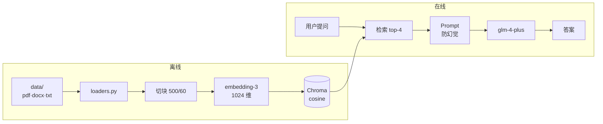

# RAG + Agent 智能客服

> 基于 LangChain + LangGraph + Chroma + 智谱 GLM 的 RAG 智能客服 Demo。
> 手写实现「加载 → 切块 → 向量化 → 入库 → 检索 → 生成」全链路，不依赖任何 RAG 封装框架，适合学习原理。

## ✨ 特性

- **手写 RAG 全链路**：每个环节独立成文件，可单独阅读、单独替换
- **双应用对比**：同一套检索内核，分别用「纯 RAG」和「ReAct Agent」两种范式实现
- **增量入库**：基于文件 sha256 指纹，只处理变化的文档，节省 Embedding 调用成本
- **中文友好切块**：自定义标点分隔符，避免中文句子被拦腰截断
- **防幻觉约束**：低 temperature + 严格的 Prompt 约束，知识库外的问题明确拒答

## 🏗 架构



两个入口：

| 应用 | 文件 | 范式 | 说明 |
|---|---|---|---|
| 服装电商客服 | `rag_app.py` | 纯 RAG | 固定流程：检索 → 作答 |
| 智扫通客服 | `agent_app.py` | ReAct Agent | LLM 自主决定调用哪些工具 |

## 🚀 快速开始

```bash
# 1. 安装依赖（Python 3.13，使用虚拟环境）
python -m venv .venv
source .venv/bin/activate        # Windows: .venv\Scripts\activate
pip install -r requirements-dev.txt     # 含运行时依赖 + pytest

# 2. 配置 API Key
cp .env.example .env
# 编辑 .env，填入你的智谱 Key（申请：https://open.bigmodel.cn/usercenter/apikeys）

# 3. 生成演示文档（可跳过，data/ 已自带）
python generate_samples.py

# 4. 构建向量库（改过 data/ 必须重跑）
python knowledge_base.py

# 5. 启动界面
streamlit run rag_app.py      # 纯 RAG（服装电商）
streamlit run agent_app.py    # ReAct Agent（扫地机器人）

# 6. 跑测试
pytest -q                     # 纯单元测试，不调 API；20 条集成评估默认跳过
```

> **所有命令都要在仓库根目录执行**：`./chroma_db` 是相对路径，在别处启动会读到空库。
> 同时开两个 app 时给第二个加 `--server.port 8502`。

### 验证是否跑通

| 提问 | 预期答案来源 |
|---|---|
| 滤网多久换一次？ | 答「3 个月」，来自 PDF |
| 退货要几天内？ | 答「7 天」，来自 DOCX |
| 100 积分抵多少钱？ | 答「1 元」，来自 TXT |
| 你们老板是谁？ | 答「知识库中暂未找到相关信息」← 防幻觉生效 |

## 📁 项目结构

```
.
├── config.py            全局配置（模型、切块参数、路径）
├── embeddings.py        智谱 Embedding 封装（实现 LangChain 接口 + 分批）
├── loaders.py           TXT/MD/PDF/DOCX 解析器
├── knowledge_base.py    离线入库脚本（含增量逻辑）
├── vector_store.py      Chroma 服务封装
├── rag_core.py          RAG 核心：LCEL 管道
├── tools.py             Agent 工具集
├── rag_app.py           Streamlit 界面 A：纯 RAG
├── agent_app.py         Streamlit 界面 B：ReAct Agent
├── generate_samples.py  生成演示文档
├── data/                知识库原始文件
├── tests/               16 条单元测试 + 20 条问答评估集
├── docs/                分层学习文档（主文档 + 3 个按需分册）
├── skills/backend-sdd/  规格驱动开发 Skill + 填好的规格示例
├── AGENTS.md            给 Agent / 新人看的项目约定（开工前必读）
└── .github/workflows/   CI：pytest + gitleaks 密钥扫描
```

## 📚 文档

- [项目架构与新人学习指南](docs/项目架构与新人学习指南.md) — **主文档**：整体架构、目录速查、一图看懂、文档导航
- [链路详解](docs/链路详解.md) — 离线入库 / 在线问答 / Agent 决策三步拆解
- [上手与练习](docs/上手与练习.md) — 跑通步骤、常见疑问、7 个动手练习
- [已知问题与改进](docs/已知问题与改进.md) — 已修复记录与演进方向
- [AGENTS.md](AGENTS.md) — 硬性约定、禁止事项、已知坑点（AI Agent 改代码前必读）

## 🛠 技术栈

| 组件 | 选型 |
|---|---|
| LLM | 智谱 `glm-4-plus` |
| Embedding | 智谱 `embedding-3`（1024 维） |
| 向量库 | Chroma（本地持久化，余弦距离） |
| 编排 | LangChain LCEL + LangGraph |
| 界面 | Streamlit |
| 文档解析 | PyMuPDF / python-docx |

## ⚠️ 注意

- **不要提交 `.env`**：API Key 只放在 `.env` 里，该文件已被 `.gitignore` 排除
- **`chroma_db/` 不入库**：跑 `python knowledge_base.py` 即可重建
- **改了 `data/` 里的文档后，必须重新跑入库脚本**，否则检索到的还是旧内容

## 📄 License

MIT
