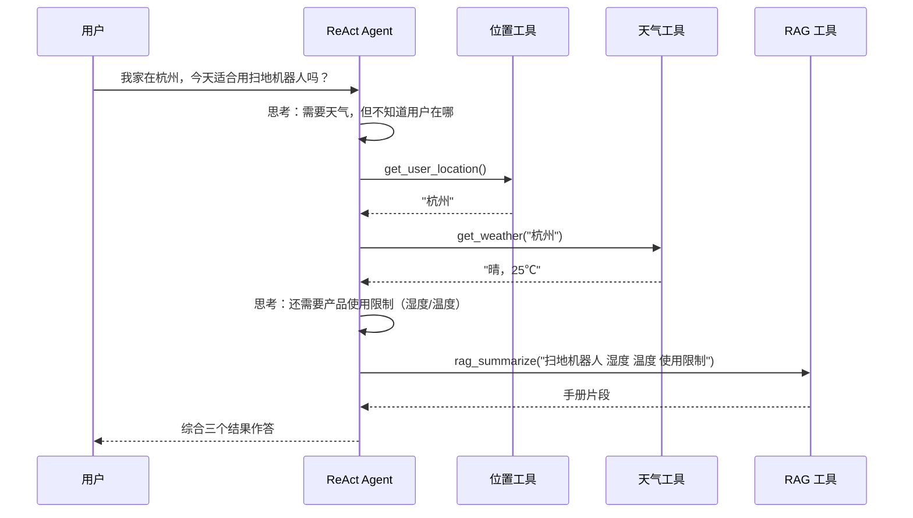

# 链路详解：离线入库 / 在线问答 / Agent 决策

> 分册，按需加载。主文档见 [项目架构与新人学习指南.md](项目架构与新人学习指南.md)。

---

## 一、离线链路：知识怎么进向量库

**入口**：`python knowledge_base.py`（或 `build(force_rebuild=True)` 全量重建）

逐步看 `build()` 干了什么：

### 1. 遍历 `data/`，按后缀过滤

```python
for p in DATA_DIR.rglob("*"):
    if not p.is_file() or p.suffix.lower() not in LOADERS:
        continue
```

`LOADERS` 是一张 `后缀 → 解析函数` 的字典，扩展新格式只需往字典里加一行——**开闭原则**的教科书写法。

### 2. 算文件指纹，判断要不要重新处理

```python
h = file_hash(p)                      # sha256 前 16 位
if not force_rebuild and state.get(p.name) == h:
    continue                          # 内容没变，跳过
```

这就是 `.ingest_state.json` 的作用：**避免每次都重新调 Embedding API**（要花钱、要等）。

### 3. 文件变了，先删旧块再写新块

```python
if p.name in state:
    vs.delete_by_source(p.name)       # delete(where={"source": p.name})
```

**最容易踩的坑**：只追加不删除，同一份文档改一次就多一份旧版片段，检索时新旧内容一起被召回，答案自相矛盾。`delete_by_source` 用 metadata 过滤做定向删除，解决了这个问题。

### 4. 解析 → 合并 → 切块

```python
raw = load_file(p)
full = "\n\n".join(d.page_content for d in raw)   # 多页 PDF 先拼成一整篇
chunks = splitter.split_text(full)
```

切块器的中文分隔符顺序是重点：

```python
separators=["\n\n", "\n", "。", "；", "！", "？", "，", " ", ""]
```

优先级从「段落」→「句子」→「分句」→「字符」逐级下降。**中文没有空格分词，直接用 LangChain 默认的 `["\n\n", "\n", " ", ""]` 会把一整句中文拦腰截断**，语义就碎了。这是中文 RAG 必须改的第一处配置。

`chunk_size=500 / overlap=60`：500 字大约是一段完整的产品说明，60 字重叠保证跨块句子不丢上下文。

### 5. 分批写库

```python
for i in range(0, len(new_docs), 200):
    vs.add_documents(new_docs[i:i + 200])
```

每块 Document 带 metadata：`{source, chunk_idx, file_type}`。`source` 是删除与溯源的关键字段——**改字段名会静默破坏增量删除逻辑**。

> 注意：`add_documents` 分批 200 是控制内存与写库事务大小；`ZhipuEmbeddings.batch_size=64` 是智谱 API 的硬限制。两个层次，不要混淆。

---

## 二、在线链路：一次提问发生了什么

以 `rag_app.py` 输入「我 170 斤适合穿什么尺码？」为例：

| 步骤 | 代码位置 | 发生了什么 |
|---|---|---|
| 1 | `st.chat_input` | 拿到问题，写入 `st.session_state.messages` |
| 2 | `get_rag()` | `@st.cache_resource` 保证进程内只构建一次 RAGService |
| 3 | `RAGService.invoke` | 进入 LCEL 管道 |
| 4 | `retriever` | 问题 → 向量 → Chroma 余弦检索 top-4 |
| 5 | `format_docs` | 4 个片段用 `\n\n` 拼成 `{context}` |
| 6 | `PROMPT` | 填入 context 和 question |
| 7 | `ChatZhipuAI` | 生成答案 |
| 8 | `StrOutputParser` | 从 AIMessage 取纯字符串 |

### LCEL 管道拆解

```python
{
  "context": retriever | format_docs,
  "question": RunnablePassthrough(),
}
| self.prompt
| self.llm
| StrOutputParser()
```

- **字典的两个 key 必须和 prompt 占位符同名**（`{context}` / `{question}`），否则运行时 KeyError。
- `|` 是**管道符**，构成 `Runnable`，天然支持 `.invoke / .batch / .stream / .ainvoke`。
- `RunnablePassthrough()` 原样透传——问题既要去检索，也要原封不动进 prompt，所以需要分叉。
- 分叉在字典里完成：同一输入并行喂给两个分支，结果合并成一个 dict。

> 心智模型：**把数据处理想成流水线，每个模块是一个可插拔的工位。**

### 防幻觉的 Prompt

```text
你是一个严谨的客服助手。请严格依据知识片段回答问题。
如果片段不足以回答，请明确说"知识库中暂未找到相关信息"，不要编造。
```

配合 `temperature=0.1`（几乎不发挥），这是客服场景的标准组合：**宁可说不知道，也不能瞎编**。答错尺码、售后政策是要赔钱的。

---

## 三、Agent 链路：从「固定流程」到「自主决策」

`rag_app.py` 的流程是**写死**的：必定检索 → 必定作答。
`agent_app.py` 换成 `create_react_agent`，流程由 **LLM 自己决定**：



### ReAct = Reasoning + Acting

```
Thought（我要干什么） → Action（调哪个工具、传什么参数）
   → Observation（工具返回什么） → 再 Thought …… → Final Answer
```

Agent 一直循环，直到认为信息够了才输出答案。

### `tools.py` 三个工具

| 工具 | 作用 | 备注 |
|---|---|---|
| `rag_summarize` | 调 `RAGService.invoke` 查知识库 | **RAG 被降级成一个工具**，这是 RAG 与 Agent 结合的典型方式 |
| `get_weather` | 查天气 | 模拟值，`GAODE_KEY` 为空时返回固定文案 |
| `get_user_location` | 定位城市 | 演示用，硬编码返回「杭州」 |

**工具的 `docstring` 就是给 LLM 看的说明书**——它靠这段文字判断「什么时候调、参数传什么」。写得含糊，Agent 就会漏调或乱调。这是 Agent 开发里最反直觉但最重要的一件事。

### 两种范式的取舍

| | 纯 RAG（`rag_app.py`） | Agent（`agent_app.py`） |
|---|---|---|
| 流程 | 固定，可预测 | 动态，LLM 决定 |
| 延迟 | 1 次 LLM 调用 | N 次（工具轮数不定） |
| 成本 | 低 | 高 |
| 能力 | 只答知识库范围内 | 可组合外部工具 |
| 适合 | 单点问答、高并发 | 多步推理、跨系统 |

**新人最容易犯的错：什么问题都用 Agent。** 业务只需要「查文档回答」时，纯 RAG 又快又稳又便宜。
