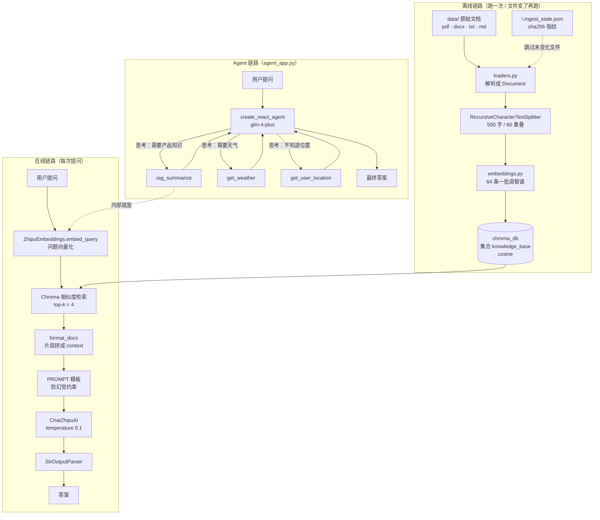
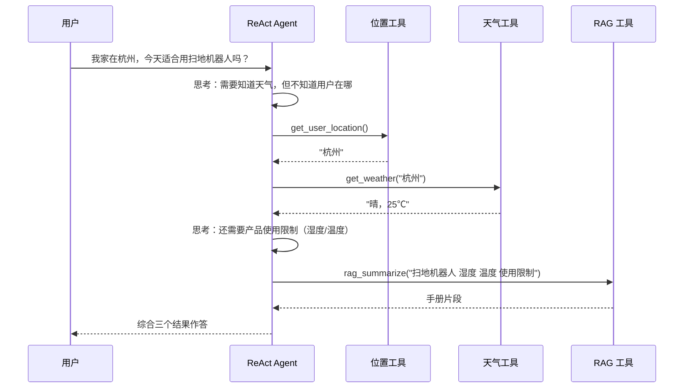

# RAG + Agent 智能客服 · 项目架构与新人学习指南

> 面向第一次接触本仓库的同学。读完这份文档，你应该能回答三个问题：
> 1. 这个项目到底在做什么？
> 2. 一次提问从输入到答案，中间经过了哪些模块？
> 3. 我想改某一块，应该动哪个文件？

---

## 一、一句话概括

这是一个**用 LangChain 手写的最小可用 RAG 系统**，并在 RAG 之上封了一层 **LangGraph ReAct Agent**，做成两个 Streamlit 聊天界面：

| 应用 | 启动文件 | 业务设定 | 能力 |
|---|---|---|---|
| 服装电商智能客服 | `rag_app.py` | 服装店的尺码、退换货、会员积分 | 纯 RAG：检索知识库 → 拼 prompt → LLM 作答 |
| 智扫通智能客服 | `agent_app.py` | 扫地机器人的参数、维护、故障 | Agent：LLM 自己决定调 `rag_summarize` / `get_weather` / `get_user_location` |

**核心价值**：它没有用任何"开箱即用"的 RAG 框架（如 LangChain 的 `create_retrieval_chain` 封装、LlamaIndex），而是把 **加载 → 切块 → 向量化 → 入库 → 检索 → 生成** 六步全部手写了一遍。所以它是学习 RAG 原理非常好的样本代码——每一步都能看懂，每一步都可以替换。

---

## 二、技术栈

| 层 | 选型 | 说明 |
|---|---|---|
| LLM | 智谱 `glm-4-plus` | 通过 `langchain_community.ChatZhipuAI` 接入 |
| Embedding | 智谱 `embedding-3`，1024 维 | 自己封装成 `ZhipuEmbeddings`，实现 LangChain 的 `Embeddings` 接口 |
| 向量库 | Chroma（本地持久化） | 数据落在 `./chroma_db/`，**余弦距离** |
| 编排 | LangChain Runnable 管道 + LangGraph | 前者做线性链，后者做 ReAct 循环 |
| UI | Streamlit | 对话式界面，`st.cache_resource` 缓存重对象 |
| 文档解析 | PyMuPDF（PDF）、python-docx（Word） | 手写 loader，不依赖 `UnstructuredFileLoader` |

依赖清单见 `requirements.txt`，版本已锁定。

---

## 三、目录与文件职责

```
agent1103/
├── config.py            全局配置：API Key、模型名、切块参数、Chroma 路径
├── embeddings.py        智谱 Embedding 封装（实现 LangChain Embeddings 接口 + 分批）
├── loaders.py           TXT / MD / PDF / DOCX 解析成 Document 列表
├── knowledge_base.py    【离线】入库脚本：扫描 data/ → 切块 → 写 Chroma（含增量逻辑）
├── vector_store.py      Chroma 服务封装：retriever / add / delete_by_source
├── rag_core.py          【在线】RAGService：组装 LCEL 管道，invoke(question) → answer
├── tools.py             把 RAGService 包成 LangChain Tool，再加两个外挂工具
├── rag_app.py           Streamlit 界面 A：纯 RAG 客服
├── agent_app.py         Streamlit 界面 B：ReAct Agent 客服
├── generate_samples.py  生成演示用样例文档（PDF / DOCX / TXT），方便跑通
├── test.py              Python 语法练习草稿，与项目无关，可忽略 / 可删
├── data/                知识库原始文件（当前 3 个：手册 PDF、售后 DOCX、综合知识 TXT）
├── chroma_db/           Chroma 持久化目录（二进制向量 + sqlite 元数据）
└── .ingest_state.json   增量入库状态：{文件名: 内容 sha256 前16位}
```

### 分层视角

```
┌──────────────────────────────────────────────┐
│  UI 层        rag_app.py     agent_app.py    │  Streamlit
├──────────────────────────────────────────────┤
│  编排层       rag_core.py    tools.py        │  LCEL / LangGraph
├──────────────────────────────────────────────┤
│  检索层       vector_store.py                │  Chroma retriever
├──────────────────────────────────────────────┤
│  模型层       embeddings.py  (ChatZhipuAI)   │  智谱 API
├──────────────────────────────────────────────┤
│  数据层       loaders.py  knowledge_base.py  │  data/ → 切块 → 入库
└──────────────────────────────────────────────┘
```

**关键点：上层只依赖下层的接口，不依赖实现。** `RAGService` 只要求传进来一个 `VectorStoreService`，你完全可以把 Chroma 换成 FAISS / Milvus，`rag_core.py` 一行都不用改。

---

## 四、整体架构图



---

## 五、离线链路：知识怎么进向量库

**入口**：`python knowledge_base.py`（或 `build(force_rebuild=True)` 全量重建）

逐步看 `build()` 干了什么：

### 1. 遍历 `data/`，按后缀过滤
```python
for p in DATA_DIR.rglob("*"):
    if not p.is_file() or p.suffix.lower() not in LOADERS:
        continue
```
`LOADERS` 是一张 `后缀 → 解析函数` 的字典，扩展新格式只需往字典里加一行——**开闭原则**的教科书写法。

### 2. 算文件指纹，判断要不要重新处理
```python
h = file_hash(p)                      # sha256 前 16 位
if not force_rebuild and state.get(p.name) == h:
    continue                          # 内容没变，跳过
```
这就是 `.ingest_state.json` 的作用：**避免每次都重新调 Embedding API（要花钱、要等）**。

### 3. 文件变了，先删旧块再写新块
```python
if p.name in state:
    vs.delete_by_source(p.name)       # delete(where={"source": p.name})
```
**这是最容易踩的坑**：如果只追加不删除，同一份文档改一次就多一份旧版片段，检索时新旧内容一起被召回，答案会自相矛盾。`delete_by_source` 用 metadata 过滤做定向删除，解决了这个问题。

### 4. 解析 → 合并 → 切块
```python
raw = load_file(p)
full = "\n\n".join(d.page_content for d in raw)   # 多页 PDF 先拼成一整篇
chunks = splitter.split_text(full)
```

切块器的中文分隔符顺序是重点：
```python
separators=["\n\n", "\n", "。", "；", "！", "？", "，", " ", ""]
```
优先级从"段落"→"句子"→"分句"→"字符"逐级下降。**中文没有空格分词，如果直接用 LangChain 默认的 `["\n\n", "\n", " ", ""]`，会把一整句中文拦腰截断**，语义就碎了。这是中文 RAG 必须改的第一处配置。

`chunk_size=500 / overlap=60`：500 字大约是一段完整的产品说明，60 字重叠保证跨块的句子不被切断时丢失上下文。

### 5. 分批写库
```python
for i in range(0, len(new_docs), 200):
    vs.add_documents(new_docs[i:i + 200])
```
每块 Document 都带 metadata：`{source, chunk_idx, file_type}`，其中 `source` 是后面删除和溯源的关键字段。

---

## 六、在线链路：一次提问发生了什么

以 `rag_app.py` 输入「我 170 斤适合穿什么尺码？」为例：

| 步骤 | 代码位置 | 发生了什么 |
|---|---|---|
| 1 | `st.chat_input` | 拿到用户问题，写入 `st.session_state.messages` |
| 2 | `get_rag()` | `@st.cache_resource` 保证整个进程只构建一次 RAGService（否则每轮都重连 Chroma） |
| 3 | `RAGService.invoke` | 进入 LCEL 管道 |
| 4 | `retriever` | 问题 → 向量 → Chroma 余弦检索 top-4 |
| 5 | `format_docs` | 4 个片段用 `\n\n` 拼成 `{context}` |
| 6 | `PROMPT` | 填入 context 和 question |
| 7 | `ChatZhipuAI` | 生成答案 |
| 8 | `StrOutputParser` | 从 AIMessage 里取出纯字符串 |

### LCEL 管道拆解

```python
{
  "context": retriever | format_docs,
  "question": RunnablePassthrough(),
}
| self.prompt
| self.llm
| StrOutputParser()
```

这段是 LangChain 表达式语言（LCEL）的核心范式，理解要点：

- **字典的两个 key 必须和 prompt 里的占位符同名**（`{context}` / `{question}`），否则运行时报 KeyError。
- `|` 是**管道符**，左边输出喂给右边输入。它构成的是一个 `Runnable`，天然支持 `.invoke / .batch / .stream / .ainvoke`。
- `RunnablePassthrough()` 表示"原样透传"——用户的问题既要去检索，也要原封不动进 prompt，所以需要分叉。
- 分叉在字典里完成：同一个输入并行喂给两个分支，结果再合并成一个 dict。

> 心智模型：**把数据处理想成流水线，每个模块是一个可插拔的工位。**

### 防幻觉的 Prompt

```text
你是一个严谨的客服助手。请严格依据知识片段回答问题。
如果片段不足以回答，请明确说"知识库中暂未找到相关信息"，不要编造。
```

配合 `temperature=0.1`（几乎不发挥），这是客服场景的标准组合：**宁可说不知道，也不能瞎编**。因为客服答错尺码、售后政策是要赔钱的。

---

## 七、Agent 链路：从"固定流程"到"自主决策"

`rag_app.py` 的流程是**写死**的：必定检索 → 必定作答。

`agent_app.py` 换成了 `create_react_agent`，流程变成**由 LLM 自己决定**：



### ReAct 循环 = Reasoning + Acting

```
Thought（我要干什么） → Action（调哪个工具、传什么参数）
   → Observation（工具返回什么） → 再 Thought …… → Final Answer
```

Agent 会一直循环，直到它认为信息够了，直接输出答案。

### `tools.py` 三个工具

| 工具 | 作用 | 备注 |
|---|---|---|
| `rag_summarize` | 调用 `RAGService.invoke` 查知识库 | **RAG 被降级成了一个工具**，这是 RAG 与 Agent 结合的典型方式 |
| `get_weather` | 查天气 | 当前是模拟值，`GAODE_KEY` 为空就返回固定文案 |
| `get_user_location` | 定位用户城市 | 演示用，硬编码返回"杭州" |

**工具的 `docstring` 就是给 LLM 看的说明书**——它靠这段文字判断"什么时候该调这个工具、参数该传什么"。写得含糊，Agent 就会漏调或乱调。这是 Agent 开发里最反直觉但最重要的一件事。

### 两个应用的取舍

| | 纯 RAG（`rag_app.py`） | Agent（`agent_app.py`） |
|---|---|---|
| 流程 | 固定，可预测 | 动态，LLM 决定 |
| 延迟 | 1 次 LLM 调用 | N 次（工具轮数不定） |
| 成本 | 低 | 高 |
| 能力 | 只能答知识库范围内 | 可组合外部工具 |
| 适合 | 单点问答、高并发 | 多步推理、跨系统 |

**新人最容易犯的错：什么问题都用 Agent。** 如果业务只需要"查文档回答"，纯 RAG 又快又稳又便宜，没必要上 Agent。

---

## 八、快速跑通

```bash
# 1. 装依赖（建议 Python 3.10+ / 虚拟环境）
pip install -r requirements.txt

# 2. 配 Key：复制模板后填入自己的智谱 Key
cp .env.example .env
#    编辑 .env → ZHIPU_API_KEY=你的key
#    申请地址：https://open.bigmodel.cn/usercenter/apikeys
#    （.env 已被 .gitignore 排除，不会误提交）

# 3. 生成演示文档到 data/
python generate_samples.py

# 4. 入库（第一次会调 Embedding API，几十秒）
python knowledge_base.py

# 5. 启动任一界面
streamlit run rag_app.py      # 服装电商（纯 RAG）
streamlit run agent_app.py    # 智扫通（Agent）
```

预期输出：
```
✅ 扫地机器人用户手册.pdf: 2 块
✅ 服装售后FAQ.docx: 1 块
✅ 综合知识.txt: 1 块
🎉 新处理 3 个文件，跳过 0 个，共 4 块
```
再次运行会全部显示「⏭ 未变化」，因为指纹没变——这就是增量入库生效了。

### 验证是否跑对

| 现象 | 说明 |
|---|---|
| 问「滤网多久换一次」 | 答"3 个月"，来自 PDF |
| 问「退货要几天内」 | 答"7 天"，来自 DOCX |
| 问「100 积分抵多少钱」 | 答"1 元"，来自 TXT |
| 问「你们老板是谁」 | 答"知识库中暂未找到相关信息" ← **这句出现了，说明防幻觉生效** |

---

## 九、新人常见疑问

**Q：为什么 `ZhipuEmbeddings` 要自己写？LangChain 没有智谱的 Embedding 吗？**
A：有，但需要额外依赖且版本兼容性差。自己实现 `Embeddings` 抽象类只需要两个方法（`embed_documents` / `embed_query`），二十行代码，可控性最高。这里的 `batch_size=64` 是智谱单次请求的条数上限，超过会报错。

**Q：为什么入库时用 `add_documents` 分批 200，而 Embedding 内部又分批 64？**
A：两个不同层次。200 是控制内存和单次写库事务大小；64 是智谱 API 的硬限制。LangChain 会自动把 200 条再切给 64 一批。

**Q：`collection_metadata={"hnsw:space": "cosine"}` 为什么一定要设？**
A：Chroma 默认是 L2 欧氏距离。文本 Embedding 关心的是**方向**而不是长度，余弦距离对归一化不敏感，中文语义检索更稳。**如果建库时设了 cosine，查询时也必须一致，否则结果会乱。**

**Q：`test.py` 是干嘛的？**
A：Python 基础语法练习（if/continue），与项目逻辑无关，删掉不影响运行。

**Q：改了 `data/` 里的文档，为什么答案没变？**
A：忘了重新跑 `python knowledge_base.py`。这是最高频的问题——**入库不是自动的**。

---

## 十、动手练习（推荐按顺序做）

| # | 练习 | 涉及文件 | 学到什么 |
|---|---|---|---|
| 1 | 往 `data/` 加一个 `.md` 文件，跑入库，验证能检索到 | `data/`, `knowledge_base.py` | 完整离线链路 |
| 2 | 改 `CHUNK_SIZE` 为 200，`force_rebuild=True` 重建，对比答案质量 | `config.py` | 切块粒度对检索的影响 |
| 3 | 把 `k` 从 4 改成 1 和 8，观察答案变化 | `rag_core.py` | top-k 的召回/噪声权衡 |
| 4 | 把 `PROMPT` 里防幻觉那句删掉，问一个知识库外的问题 | `rag_core.py` | 幻觉是怎么产生的 |
| 5 | 在 `tools.py` 加一个 `get_order_status(order_id)` 工具 | `tools.py` | Agent 工具的定义与注册 |
| 6 | 给 `load_pdf` 的 chunk metadata 加上 `page` 号并透传到答案 | `loaders.py` | 检索溯源 |
| 7 | 把 `VectorStoreService` 换成 `InMemoryVectorStore` | `vector_store.py` | 面向接口编程的收益 |

---

## 十一、已知问题与改进方向

阅读代码时发现的几处值得注意的地方，按优先级排：

### ✅ 已修复：API Key 曾硬编码在 `config.py`

早期版本长这样，第二个参数是**真实可用的 Key**：

```python
ZHIPU_API_KEY = os.getenv("ZHIPU_API_KEY", "<你的真实Key>")
```

这种写法有两个问题：Key 一旦推到 Git 就等于永久泄露（删掉也能从历史里翻出来）；Key 失效时程序不报错，而是静默走到 401，排查困难。

**现已改为从 `.env` 读取 + 缺失即抛错：**

```python
from dotenv import load_dotenv
load_dotenv(Path(__file__).parent / ".env")

ZHIPU_API_KEY = os.getenv("ZHIPU_API_KEY")
if not ZHIPU_API_KEY:
    raise RuntimeError("未找到 ZHIPU_API_KEY，请复制 .env.example 为 .env 并填入")
```

配套：`.env` 已加入 `.gitignore`，仓库只提交 `.env.example` 占位模板。

### 🟠 中：`tools.py` 的工具描述是从服装项目复制来的
`rag_summarize` 的 docstring 写着"尺码、售后政策"——但 `agent_app.py` 是**扫地机器人**客服。这会让 Agent 在问扫地机故障时犹豫要不要调这个工具。应该改成"产品参数、使用说明、故障排查、保养维护"。

### 🟠 中：PDF 的 `page` 元数据在切块时丢了
`loaders.load_pdf` 给每页打了 `page` 标记，但 `knowledge_base.build` 里 `"\n\n".join(...)` 拼成整篇后重新切块，`page` 就没了，只剩 `source`。如果要做"引用第几页"，需要改成逐页切块，或把页码映射写进 chunk metadata。

### 🟡 低：`state` 用文件名做 key
`state.get(p.name)` 只取文件名不含路径。如果 `data/` 下不同子目录有同名文件，会互相覆盖跳过。改成相对路径 `str(p.relative_to(DATA_DIR))` 更稳。

### 🟡 低：`get_weather` / `get_user_location` 是硬编码
`tools.py` 里 `return "杭州"`、`return "晴，25℃"`。接真实高德 API 时替换这两处即可，`GAODE_KEY` 已经预留好了。

### 🟡 低：没有重排（Rerank）
纯向量 top-4 已经够演示，但生产环境通常加一层 Rerank（如 `bge-reranker`）把召回的 20 条精排到 4 条，能显著提升准确率。

### 🟡 低：没有评估集
建议准备 20~30 条「问题 → 标准答案」的测试集，改切块参数/top-k 时跑一遍算命中率，否则调参全靠感觉。

---

## 十二、一句话记住整个项目

> **离线把文档切碎、变成向量存进 Chroma；在线把问题变成向量、捞回最像的几段、塞给大模型让它照着答。Agent 则是在这之上，让大模型自己决定"要不要查、查几次、还查不查别的"。**

---

*文档基于当前代码状态整理。代码改动后，请同步更新本文档。*
