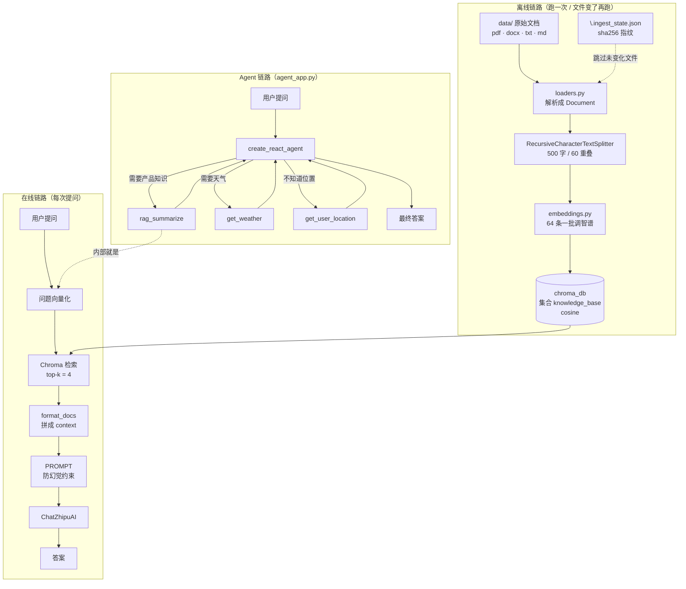

# RAG + Agent 智能客服 · 架构与学习指南（主文档）

> **这份是入口，不是全集。** 建议先花 5 分钟读完本页，再按「文档导航」按需加载分册。
> 一次把全部细节塞进上下文，反而会让注意力稀释——对人和对 Agent 都是一样。

读完本页，你应该能回答三个问题：
1. 这个项目在做什么？ 2. 一次提问经过哪些模块？ 3. 想改某块该动哪个文件？

---

## 一、一句话概括

**用 LangChain 手写的最小可用 RAG 系统**，并在 RAG 之上封了一层 **LangGraph ReAct Agent**，做成两个 Streamlit 聊天界面：

| 应用 | 启动文件 | 业务设定 | 能力 |
|---|---|---|---|
| 服装电商客服 | `rag_app.py` | 尺码、退换货、会员积分 | 纯 RAG：检索 → 拼 prompt → LLM 作答 |
| 智扫通客服 | `agent_app.py` | 扫地机器人参数、维护、故障 | Agent：自主决定调 `rag_summarize` / `get_weather` / `get_user_location` |

**核心价值**：没用任何开箱即用的 RAG 封装，把 **加载 → 切块 → 向量化 → 入库 → 检索 → 生成** 六步全部手写了一遍。每一步都看得懂、都能单独替换——这是学习 RAG 原理的好样本。

---

## 二、技术栈

| 层 | 选型 |
|---|---|
| LLM | 智谱 `glm-4-plus`（`temperature=0.1`） |
| Embedding | 智谱 `embedding-3`，1024 维，自封装 `ZhipuEmbeddings` |
| 向量库 | Chroma 本地持久化，**余弦距离** |
| 编排 | LangChain LCEL 管道 + LangGraph ReAct |
| UI | Streamlit（`st.cache_resource` 缓存重对象） |
| 文档解析 | PyMuPDF / python-docx，手写 loader |

运行环境 Python 3.13，版本锁在 `requirements.txt`，测试依赖在 `requirements-dev.txt`。

---

## 三、目录速查

```
├── config.py             全局配置（Key / 模型 / 维度 / 切块 / 路径）
├── embeddings.py         智谱 Embedding 封装 + 64 条分批
├── loaders.py            TXT / MD / PDF / DOCX → Document
├── knowledge_base.py     【离线】入库：sha256 增量、切块、写库
├── vector_store.py       Chroma 封装：retriever / add / delete_by_source
├── rag_core.py           【在线】LCEL 管道 + 防幻觉 Prompt
├── tools.py              三个 Agent 工具（RAG 被包装成其中之一）
├── rag_app.py            界面 A：纯 RAG
├── agent_app.py          界面 B：ReAct Agent
├── generate_samples.py   生成演示文档
├── data/                 知识库原始文件（3 个）
├── tests/                单元测试 + 20 条评估集
├── docs/                 分层文档（你正在读）
├── skills/backend-sdd/   规格驱动开发 Skill
├── AGENTS.md             给 Agent 看的项目约定 ★ 开工前必读
└── .github/workflows/    CI：pytest + 密钥扫描
```

**不入库**：`.env`、`.venv/`、`chroma_db/`、`.ingest_state.json`。

### 分层视角

```
┌──────────────────────────────────────────────┐
│  UI 层        rag_app.py     agent_app.py    │  Streamlit
├──────────────────────────────────────────────┤
│  编排层       rag_core.py    tools.py        │  LCEL / LangGraph
├──────────────────────────────────────────────┤
│  检索层       vector_store.py                │  Chroma retriever
├──────────────────────────────────────────────┤
│  模型层       embeddings.py  (ChatZhipuAI)   │  智谱 API
├──────────────────────────────────────────────┤
│  数据层       loaders.py  knowledge_base.py  │  data/ → 切块 → 入库
└──────────────────────────────────────────────┘
```

> **上层只依赖下层的接口，不依赖实现。** `RAGService` 只要求传入一个 `VectorStoreService`，
> 把 Chroma 换成 FAISS / Milvus，`rag_core.py` 一行都不用改。

---

## 四、整体架构图



---

## 五、文档导航（按需加载）

| 你现在要做什么 | 读哪个 |
|---|---|
| **Agent 改代码前，取项目约定与禁止事项** | [`AGENTS.md`](../AGENTS.md) |
| 理解离线 / 在线 / Agent 三条链路的每一步 | [链路详解.md](链路详解.md) |
| 把项目跑起来、验证结果、做练习 | [上手与练习.md](上手与练习.md) |
| 看已知问题、改进方向、已修复记录 | [已知问题与改进.md](已知问题与改进.md) |
| 学习「规格驱动开发」怎么写规格 | [skills/backend-sdd/SKILL.md](../skills/backend-sdd/SKILL.md) |

---

## 六、一句话记住整个项目

> **离线把文档切碎、变成向量存进 Chroma；在线把问题变成向量、捞回最像的几段、塞给大模型让它照着答。Agent 则是在这之上，让大模型自己决定「要不要查、查几次、还查不查别的」。**

---

*代码改动后请同步更新对应分册。已知坑点回写到 `AGENTS.md`，不要散落在对话里。*
